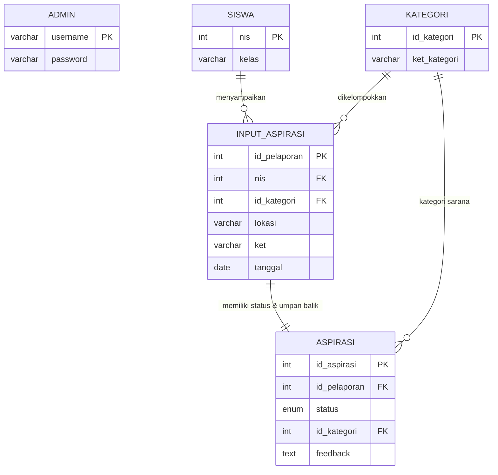

# DOKUMENTASI UJI KOMPETENSI KEAHLIAN (UKK) 2025/2026
**Paket 3 - Rekayasa Perangkat Lunak (RPL)**  
**Judul Tugas: Pengembangan Aplikasi Pengaduan Sarana Sekolah**  
**Teknologi:** PHP 8.2 (Native), MySQL, HTML5 Semantik (Tanpa CSS)

---

## 1. DESKRIPSI PROGRAM
Aplikasi Pengaduan Sarana Sekolah adalah sistem informasi berbasis web yang dirancang untuk mendukung proses input dan output penanganan sarana dan prasarana sekolah agar berjalan efektif dan efisien.

Aplikasi ini memiliki 2 peran utama:
1. **Siswa**:
   - Menyampaikan pengaduan/keluhan kerusakan sarana sekolah melalui **Formulir Aspirasi Siswa**.
   - Memantau status penyelesaian perbaikan sarana (`Menunggu`, `Proses`, `Selesai`) melalui **Histori Aspirasi Siswa**.
   - Melihat catatan umpan balik (*feedback*) resmi dari pihak sekolah.
2. **Administrator / Petugas Sarpras**:
   - Melakukan autentikasi login petugas.
   - Melihat daftar keseluruhan aspirasi siswa.
   - Menyaring (filter) laporan pengaduan berdasarkan:
     - Tanggal spesifik
     - Bulan & Tahun
     - Siswa (NIS)
     - Kategori sarana
   - Mengubah status penyelesaian dan memberikan umpan balik (*feedback*) kepada siswa melalui **Halaman Umpan Balik Aspirasi**.
   - Mengelola data kategori sarana sekolah (tambah dan hapus kategori).

---

## 2. DIAGRAM HUBUNGAN ENTITAS (ERD)

### Visualisasi Relasi Antar Tabel (Mermaid Diagram)


### Penjelasan Struktur Tabel:
1. **admin**: Menyimpan kredensial administrator (`username` sebagai PK, `password` berformat hash).
2. **siswa**: Menyimpan identitas siswa (`nis` sebagai PK, `kelas`).
3. **kategori**: Menyimpan jenis/kelompok sarana (`id_kategori` AUTO_INCREMENT sebagai PK, `ket_kategori`).
4. **input_aspirasi**: Menyimpan data pelaporan yang diinputkan oleh siswa (`id_pelaporan` PK, relasi ke `nis`, relasi ke `id_kategori`, `lokasi`, `ket`, serta `tanggal`).
5. **aspirasi**: Menyimpan status perbaikan dan tanggapan/umpan balik dari pihak sekolah (`id_aspirasi` PK, `id_pelaporan` FK, `status` ENUM['Menunggu','Proses','Selesai'], `id_kategori` FK, dan `feedback`).

---

## 3. DOKUMENTASI PROSEDUR DAN FUNGSI (file: `fungsi.php`)

Sesuai arahan panduan kerja, logika program disusun modular menggunakan fungsi dan prosedur:

| Nama Fungsi / Prosedur | Tipe | Parameter | Deskripsi Kegunaan |
|---|---|---|---|
| `daftar_status()` | Fungsi (Array) | - | Mengembalikan daftar status valid: `['Menunggu', 'Proses', 'Selesai']`. |
| `daftar_bulan()` | Fungsi (Array) | - | Mengembalikan daftar nama bulan 1 - 12 dalam Bahasa Indonesia. |
| `format_tanggal_indonesia($tanggal)` | Fungsi (String) | `?string $tanggal` | Mengubah format tanggal MySQL (`YYYY-MM-DD`) menjadi format Indonesia (contoh: `15 Februari 2026`). |
| `ambil_semua_kategori()` | Fungsi (Array) | - | Mengambil seluruh data kategori sarana dari database. |
| `tambah_kategori($ket_kategori)` | Prosedur (Bool) | `string $ket_kategori` | Menambahkan data kategori baru ke tabel `kategori`. |
| `hapus_kategori($id_kategori)` | Prosedur (Bool) | `int $id_kategori` | Menghapus data kategori berdasarkan ID. |
| `simpan_aspirasi($nis, $kelas, $id_kategori, $lokasi, $ket)` | Prosedur (Int/Bool) | `$nis, $kelas, $id_kategori, $lokasi, $ket` | Mendaftarkan siswa jika belum ada, menyimpan data ke `input_aspirasi`, lalu membuat entri status awal di `aspirasi`. Mengembalikan `id_pelaporan`. |
| `ambil_aspirasi_siswa($nis)` | Fungsi (Array) | `int $nis` | Mengambil riwayat aspirasi spesifik seorang siswa dengan query JOIN efisien. |
| `ambil_semua_aspirasi($filter)` | Fungsi (Array) | `array $filter` | Mengambil seluruh aspirasi dengan filter gabungan (tanggal, bulan, tahun, NIS, kategori). |
| `ambil_aspirasi_by_id($id_aspirasi)` | Fungsi (Array/Null) | `int $id_aspirasi` | Mengambil data lengkap 1 aspirasi untuk form umpan balik admin. |
| `simpan_umpan_balik($id_aspirasi, $status, $feedback)` | Prosedur (Bool) | `$id_aspirasi, $status, $feedback` | Memperbarui status perbaikan dan umpan balik resmi dari admin. |
| `proses_login_admin($username, $password)` | Fungsi (Bool) | `$username, $password` | Memvalidasi kecocokan data login admin. |
| `wajib_login_admin()` | Prosedur | - | Memproteksi halaman admin; mengarahkan ke `login.php` jika belum login. |

---

## 4. PANDUAN INSTALASI & PENGUJIAN (DEBUGGING)

### Langkah Pemasangan:
1. Pastikan web server lokal (Apache & MySQL pada XAMPP / Laragon / Homebrew) sudah berjalan.
2. Import file database **`db.sql`** melalui phpMyAdmin atau terminal:
   ```bash
   mysql -u root -p < db.sql
   ```
3. Konfigurasi database dipisahkan di file **`config.php`** (diabaikan oleh Git melalui `.gitignore` demi keamanan):
   - Salin file template `config.example.php` menjadi `config.php`.
   - Sesuaikan `username`, `password`, dan `database` pada `config.php`.
4. Akses aplikasi melalui browser pada URL lokal (contoh: `http://localhost/ukk2026paket3/` atau `http://ukk2026paket3.test`).

### Akun Uji Coba:
- **Akun Admin**:
  - Username: `admin`
  - Password: `admin123`
- **Data Siswa Awal**:
  - NIS: `1021001` (Kelas XII RPL 1)
  - NIS: `1021002` (Kelas XII RPL 2)
  - NIS: `1021003` (Kelas XII TKJ 1)

### Panduan Debugging & Troubleshooting:
| Gejala Kendala | Penyebab Umum | Solusi Perbaikan |
|---|---|---|
| `Gagal Terhubung ke Database!` | Layanan MySQL mati atau username/password salah. | Buka `koneksi.php`, periksa nilai `$host`, `$username`, `$password`, dan pastikan database `ukk_pengaduan_sarana` sudah di-import. |
| Data pengaduan siswa tidak muncul di histori | NIS yang dicari berbeda dengan saat submit form. | Pastikan memasukkan NIS yang persis sama saat mencari di menu Histori. |
| Tidak bisa membuka menu Kelola Aspirasi | Sesi login belum aktif. | Masuk terlebih dahulu melalui menu `login.php` menggunakan akun admin. |

---

## 5. CATATAN PENERAPAN CSS MASA DEPAN OLEH SISWA
Aplikasi ini sengaja dibuat **tanpa CSS sama sekali** agar siswa dapat mempelajari logika dasar PHP Native dan alur data dengan jernih tanpa terdistraksi tampilan.

Namun, **seluruh struktur HTML telah disiapkan secara semantik** lengkap dengan `class` dan `id` standar industri, antara lain:
- Kontainer: `.container`, `.card`, `.card-header`, `.card-body`
- Navigasi: `.navbar`, `.nav-list`, `.nav-item`, `.nav-link`
- Formulir: `.form-group`, `.form-label`, `.form-control`, `.form-select`
- Tombol: `.btn`, `.btn-primary`, `.btn-secondary`, `.btn-danger`
- Tabel & Lencana: `.table`, `.table-bordered`, `.table-striped`, `.badge-warning`, `.badge-info`, `.badge-success`
- Notifikasi: `.alert`, `.alert-success`, `.alert-danger`, `.alert-info`

**Untuk menambahkan CSS:**
Siswa cukup membuat file baru bernama `style.css` di direktori proyek, kemudian menambahkan baris berikut di dalam tag `<head>` pada file `header.php`:
```html
<link rel="stylesheet" href="style.css">
```

---

## 6. LAPORAN EVALUASI SINGKAT
Aplikasi ini telah memenuhi seluruh kriteria kelulusan UKK Paket 3 RPL:
1. **Fungsionalitas**: Berjalan 100% untuk alur pengaduan siswa, pelacakan histori, umpan balik admin, perubahan status, dan filtering data.
2. **Kesesuaian Spesifikasi**: Memenuhi skema ERD 5 tabel sesuai Gambar Kerja, mendukung 2 halaman utama dan pelaporan per tanggal/bulan/siswa/kategori.
3. **Kualitas Kode**: Menggunakan PHP Native 8.2 yang aman (prepared statements untuk mencegah SQL Injection, htmlspecialchars untuk mencegah XSS), bersih, terstruktur rapi dengan prosedur/fungsi dan array.
