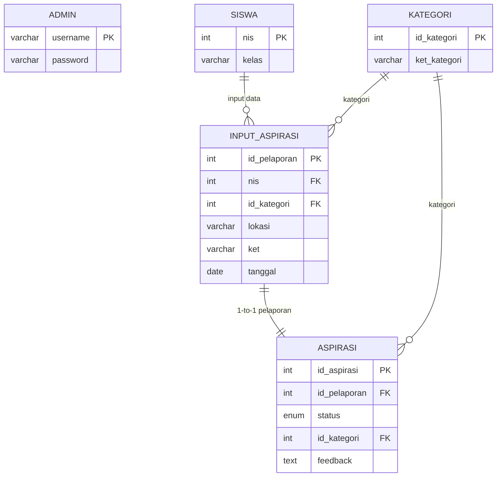

# Aplikasi Pengaduan Sarana Sekolah
**Uji Kompetensi Keahlian (UKK) SMK Tahun Pelajaran 2025/2026**  
**Bidang Keahlian:** Rekayasa Perangkat Lunak (RPL) &mdash; **Paket 3**

Aplikasi web sederhana berbasis **PHP 8.2 Native** dan **MySQL** yang dibuat sebagai contoh acuan pembelajaran bagi siswa SMK dalam menyelesaikan penugasan UKK Paket 3.

Aplikasi ini dibangun **tanpa framework** dan **murni menggunakan HTML5 semantik tanpa CSS sama sekali**, namun seluruh elemen telah dilengkapi `class` dan `id` standar sehingga sangat mudah bagi siswa untuk mengimplementasikan styling CSS di kemudian hari.

---

## Daftar Isi
1. [Fitur Aplikasi](#fitur-aplikasi)
2. [Kebutuhan Sistem](#kebutuhan-sistem)
3. [Struktur Direktori Proyek](#struktur-direktori-proyek)
4. [Panduan Instalasi & Menjalankan](#panduan-instalasi--menjalankan)
5. [Akun Pengujian (Testing)](#akun-pengujian-testing)
6. [Struktur Database & ERD](#struktur-database--erd)
7. [Panduan Implementasi CSS untuk Siswa](#panduan-implementasi-css-untuk-siswa)
8. [Dokumentasi Lengkap](#dokumentasi-lengkap)

---

## Fitur Aplikasi

Sesuai dengan lembar soal UKK 2025/2026 Paket 3, aplikasi terdiri dari 2 peran dan 2 halaman utama:

### 1. Peran Siswa
- **Form Aspirasi Siswa (Halaman Utama 1)**: Formulir untuk menyampaikan keluhan/pengaduan sarana dan prasarana sekolah (NIS, Kelas, Kategori Sarana, Lokasi, Keterangan Kerusakan).
- **Histori & Status Aspirasi**: Siswa dapat melacak pengaduan berdasarkan NIS, melihat status perbaikan (`Menunggu`, `Proses`, `Selesai`), dan membaca umpan balik (*feedback*) resmi dari sekolah.

### 2. Peran Administrator / Petugas Sarpras
- **Autentikasi Petugas**: Login dan logout sesi admin yang aman.
- **List Aspirasi Keseluruhan**: Tabel histori pengaduan seluruh siswa dilengkapi **4 Filter Pencarian**:
  1. Filter per Tanggal spesifik.
  2. Filter per Bulan & Tahun.
  3. Filter per Siswa (berdasarkan NIS).
  4. Filter per Kategori Sarana.
- **Umpan Balik Aspirasi (Halaman Utama 2)**: Form untuk mengubah status penyelesaian pengaduan dan menuliskan umpan balik/tindakan perbaikan bagi siswa.
- **Kelola Kategori**: Menambah dan menghapus kategori sarana sekolah.

---

## Kebutuhan Sistem
- **PHP**: Versi 8.2 atau lebih baru.
- **MySQL / MariaDB**: Server database aktif (XAMPP / Laragon / Homebrew / MAMP).
- **Web Browser**: Chrome, Firefox, Edge, Safari, dll.

---

## Struktur Direktori Proyek

```text
ukk2026paket3/
├── .gitignore             # Mengabaikan file sensitif lokal (config.php, .DS_Store)
├── config.example.php     # Template konfigurasi database untuk Git
├── config.php             # Kredensial database lokal (tidak masuk ke Git)
├── db.sql                 # Skema 5 tabel database & data awal uji coba
├── koneksi.php            # File koneksi MySQLi (otomatis membaca config.php)
├── fungsi.php             # Kumpulan prosedur, fungsi, dan array (modular)
├── header.php             # Kerangka atas HTML semantik & navigasi menu
├── footer.php             # Kerangka bawah HTML semantik
├── index.php              # Halaman Utama 1: Form Pengaduan Siswa
├── histori.php            # Halaman Histori & Lacak Status Siswa
├── login.php              # Halaman Login Admin
├── logout.php             # Handler Logout Admin
├── admin_aspirasi.php     # Panel Admin: Daftar Aspirasi & 4 Filter
├── admin_umpan_balik.php  # Halaman Utama 2: Form Feedback & Ubah Status
├── admin_kategori.php     # Panel Admin: Kelola Data Kategori Sarana
├── DOKUMENTASI.md         # Dokumentasi teknis lengkap pengumpulan UKK
└── README.md              # Petunjuk utama proyek ini
```

---

## Panduan Instalasi & Menjalankan

### Langkah 1: Siapkan File Database
Import file `db.sql` ke database MySQL Anda:
- **Melalui Terminal**:
  ```bash
  mysql -u root -p < db.sql
  ```
- **Atau Melalui phpMyAdmin**:
  Buka `http://localhost/phpmyadmin` &rarr; Buat database atau langsung pilih menu **Import** &rarr; Pilih file `db.sql` &rarr; Klik **Kirim (Go)**.

### Langkah 2: Konfigurasi Database Lokal
Salin file `config.example.php` menjadi `config.php`:
```bash
cp config.example.php config.php
```
Buka file `config.php` dan sesuaikan username, password, serta nama database lokal Anda:
```php
return [
    'host'     => 'localhost',
    'username' => 'root',
    'password' => '',              // Isi password MySQL Anda jika ada
    'database' => 'ukk_pengaduan_sarana', // Atau nama database Anda
];
```

### Langkah 3: Jalankan Aplikasi
- Jika menggunakan Apache (XAMPP / Laragon):
  Akses di browser melalui `http://localhost/ukk2026paket3/`
- Jika menggunakan built-in web server PHP:
  ```bash
  php -S localhost:8000
  ```
  Lalu buka `http://localhost:8000` di browser.

---

## Akun Pengujian (Testing)

### Akun Administrator:
- **URL Login**: `login.php`
- **Username**: `admin`
- **Password**: `admin123`

### Data Siswa Contoh (untuk pengujian pelaporan & pencarian):
- NIS: `1021001` (Kelas XII RPL 1)
- NIS: `1021002` (Kelas XII RPL 2)
- NIS: `1021003` (Kelas XII TKJ 1)

*(Catatan: Siswa baru dapat langsung mengisi form di `index.php`; sistem akan otomatis mendaftarkan NIS dan kelas siswa ke database).*

---

## Struktur Database & ERD

Sesuai Gambar Kerja UKK Paket 3 Halaman 4, database terdiri atas 5 entitas:



---

## Panduan Implementasi CSS untuk Siswa

Aplikasi ini sengaja **tidak memakai CSS** agar siswa fokus memahami alur logika backend (input data, manipulasi database, filtering, dan autentikasi sesi).

Namun, seluruh halaman sudah dirancang dengan **class dan ID semantik yang lengkap**, seperti:
- Kontainer & Kartu: `.container`, `.card`, `.card-header`, `.card-body`
- Navigasi: `.navbar`, `.nav-list`, `.nav-item`, `.nav-link`
- Form: `.form-group`, `.form-label`, `.form-control`, `.form-select`
- Tombol: `.btn`, `.btn-primary`, `.btn-secondary`, `.btn-danger`
- Tabel & Lencana: `.table`, `.table-bordered`, `.badge`, `.badge-warning`, `.badge-info`, `.badge-success`
- Notifikasi: `.alert`, `.alert-success`, `.alert-danger`, `.alert-info`

### Cara Menghubungkan CSS:
1. Buat file baru bernama `style.css` di folder utama aplikasi.
2. Buka file `header.php` pada baris ke-25, lalu aktifkan tag link berikut:
   ```html
   <link rel="stylesheet" href="style.css">
   ```
3. Siswa dapat langsung menuliskan kode CSS sesuai kreativitas masing-masing menggunakan class-class di atas.

---

## Dokumentasi Lengkap
Laporan proyek resmi UKK yang mencakup:
- Deskripsi Program
- ERD Detail
- Dokumentasi Fungsi & Prosedur
- Panduan Debugging & Troubleshooting
- Laporan Evaluasi Singkat

Dapat dilihat pada file [DOKUMENTASI.md](DOKUMENTASI.md).

---
**Pengembang:** Junior Assistant Programmer (Siswa Kelas XII RPL)  
**Tahun Pelajaran:** 2025/2026 &mdash; Paket 3
